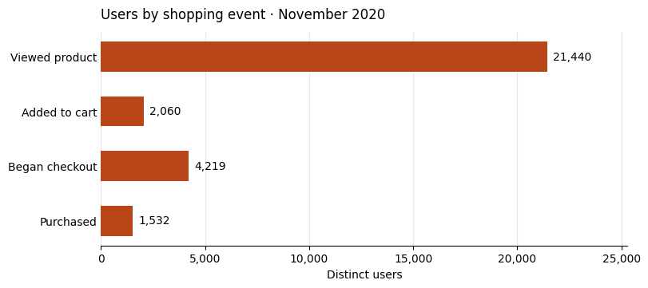

# Julia Zagdańska

**Analiza danych · Ekonomia**

### 🎯 O mnie

Studiuję ekonomię na Uniwersytecie Ekonomicznym w Poznaniu. Na ostatnim stażu w zespole Master Data w ROCKWOOL pracowałam z danymi klientów w SAP, przygotowywałam raporty i sprawdzałam przyczyny błędów w danych. W pracy magisterskiej analizuję model biznesowy Revoluta i rozwój firmy w latach 2021–2025.

### 🗂️ Moje projekty

- [📊 Analiza konwersji zakupowej](https://github.com/JuliaZagdanska/ecommerce-conversion-analysis) – W publicznej próbce GA4 Google Merchandise Store **7,07%** oglądających produkty dokonało pierwszego zakupu po pierwszym wyświetleniu w badanym miesiącu. Sprawdziłam też, jak wynik różnił się między telefonem a komputerem. W repozytorium można prześledzić zapytania, definicje metryk i wnioski.

### 🛠️ Narzędzia

- **SQL** (BigQuery, SQLite)
- **Python** (Pandas, Matplotlib)
- **Microsoft Excel**, **Power BI**, **Looker Studio**
- **SAP**

### 🎓 Wybrane kursy

- **Introduction to Power BI** – DataCamp
- **SQL Essentials**
- **EY Strategy and Corporate Finance** – EY, styczeń 2026
- **Designing for User Experience** – Microsoft, sierpień 2024
- **Fundamentals of UI/UX Design** – Microsoft, sierpień 2024

### 🚀 Cel

Szukam stażu w analizie danych, biznesowej lub produktowej. Chcę rozwijać się w analizie zachowań użytkowników i przygotowywaniu wniosków, które pomagają zespołom podejmować decyzje.

### 📬 Kontakt

[LinkedIn](https://www.linkedin.com/in/julia-zagda%C5%84ska-1370b32b7/)
